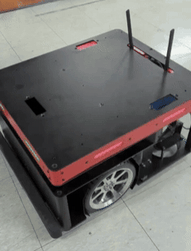
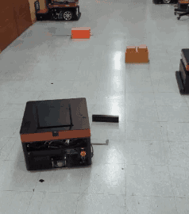
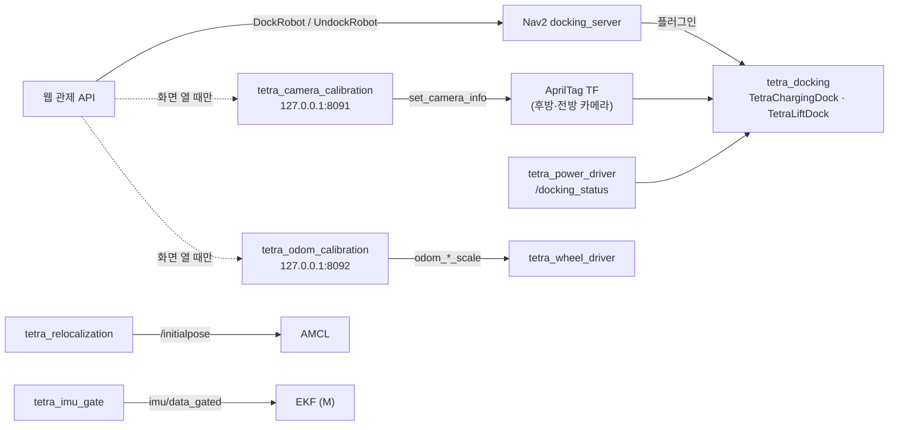

<div align="center">
  <table>
    <tr>
      <td align="center"></td>
      <td align="center"></td>
    </tr>
    <tr>
      <td align="center"><sub>TETRA-M</sub></td>
      <td align="center"><sub>TETRA-S</sub></td>
    </tr>
  </table>
  <h1>tetra_util</h1>
  <p><b>TETRA 자동 충전 도킹과 현장 보정·위치 복구 도구 모음</b></p>
  
  
  
  
</div>

> 전체 시스템(웹 관제, 브링업, 다른 ROS 패키지)은 [tetra_integration README](https://github.com/TETRA-ROBOT/tetra_integration) 를 보세요.

## 한눈에 보기

- **`tetra_docking`**: Nav2 docking_server 에 끼우는 도킹 플러그인. AprilTag(또는 라이다 V 홈)를 보고 충전 스테이션에 붙고, 리프트 포트에 들어갑니다.
- **보정 도구 2개**: 웹 관제 관리자 화면이 열 때만 띄웁니다. 카메라 내부 파라미터(`tetra_camera_calibration`), 바퀴 오도메트리 배율(`tetra_odom_calibration`).
- **위치·방향 지킴이 2개**: AMCL 이 위치를 잃으면 스캔으로 다시 잡고(`tetra_relocalization`), 바퀴가 서 있는 동안 자이로 영점 오차가 EKF 로 새지 않게 막습니다(`tetra_imu_gate`).

<p align="center"></p>



## 🚀 빠른 시작

1. 빌드합니다 (워크스페이스 루트).
   ```bash
   colcon build --symlink-install --packages-select tetra_docking tetra_relocalization tetra_imu_gate tetra_camera_calibration tetra_odom_calibration
   source install/setup.bash
   ```
2. 따로 띄울 것은 없습니다. 브링업·내비게이션 런치가 필요한 것을 띄웁니다.
   - 도킹 플러그인: 모델별 `tetra_config/tetra_navigation2/params/navigation_*.yaml` 의 `docking_server.dock_plugins`
   - `auto_relocalizer`: 2D 내비게이션 런치가 `auto_relocalization_launch.py` 로 (`auto_relocalize:=false` 로 끔)
   - `imu_standstill_gate`: M 브링업(`tetra_bringup_m.launch.py`)
   - 두 보정 노드: 웹 관제 관리자 화면을 열 때 API 가 띄우고 떠날 때 끕니다
3. 도킹은 웹 관제에서 시작합니다. 관제가 목표 직전에 도킹 영점·속도·검출 방식을 파라미터로 넣고 `DockRobot` 액션을 보냅니다.

## 📦 구성

| 패키지 | 하는 일 | 실행 파일 / 플러그인 | 자세히 |
|---|---|---|---|
| `tetra_docking/` | 충전 스테이션·리프트 포트 도킹 (C++, opennav_docking 플러그인) | `tetra_docking::TetraChargingDock`, `tetra_docking::TetraLiftDock` | [CONTEXT.md](CONTEXT.md) |
| `tetra_relocalization/` | AMCL 이 위치를 잃으면 스캔-지도 맞춤으로 `/initialpose` | `auto_relocalizer` | [README](tetra_relocalization/README.md) |
| `tetra_imu_gate/` | 바퀴가 서 있는 동안 `imu/data` 를 EKF 로 넘기지 않음 (M) | `imu_standstill_gate` | `tetra_imu_gate/gate.py` 주석 |
| `tetra_camera_calibration/` | 체커보드로 카메라 내부 파라미터를 재고 `set_camera_info` 로 적용 | `calibrator` | 아래 표 |
| `tetra_odom_calibration/` | 천천히 직진·회전시키고 스캔 맞춤으로 바퀴 오도메트리 배율 측정·적용 | `calibrator` | [README](tetra_odom_calibration/README.md) |
| `etc/img/` | 로봇 원본 GIF (`m.gif`, `s.gif`). README 는 `docs/images/` 의 줄인 사본을 씁니다 | - | - |

## 🧭 자주 하는 작업

| 하고 싶은 일 | 방법 |
|---|---|
| 도킹 / 언도킹 | 웹 관제의 도킹 버튼 (API 가 영점·속도를 넣고 `DockRobot`·`UndockRobot` 을 보냄) |
| 로봇마다 다른 충전 위치 오차 맞추기 | 관리자 설정 → **도킹 영점** (`dock_offset_x/_y/_yaw`, 0.1 m·10° 넘으면 거부) |
| 도크 앞 접근 속도 바꾸기 | 관리자 설정 → **도킹 속도**·**감속 시작 거리** (docking_server `controller.*` 를 목표 직전에 넣음) |
| 카메라 캘리브레이션 | 관리자 화면 → 카메라 캘리브레이션 (`tetra_camera_calibration`) |
| 바퀴 오도메트리 보정 | 관리자 화면 → 바퀴 오도메트리 보정 (`tetra_odom_calibration`) |
| 자동 위치 복구가 무엇을 했는지 보기 | `ros2 topic echo /auto_relocalizer/event` |
| 지금 자세가 지도와 얼마나 맞는지 | `ros2 topic echo /auto_relocalizer/scan_match_ratio` |
| IMU 를 막고 있는지 (M) | `ros2 topic echo /imu_standstill_gate/imu_blocked` |
| 계산 코드 테스트 (ROS 없이) | `colcon test --packages-select tetra_docking` / 각 Python 패키지에서 `python3 -m pytest test` |

### 도킹이 하는 일 (태그 모드)

위 애니메이션의 4단계입니다. 매 주기 순서는 `src/refined_pose.cpp` 의 `refineFromTagDetection` 에 있습니다.

| 단계 | 하는 일 | 관련 파라미터 (플러그인) | 소스 |
|---|---|---|---|
| ① staging 으로 이동 | 태그가 보이면 0.6초 검출 평균으로 태그 정면 축 위 지점을, 아니면 등록된 도크 자세 + `staging_x_offset` 을 Nav2 목표로 | `tag_staging`, `tag_staging_distance(_min/_max)`, `tag_staging_frame` | `tag_staging.cpp` |
| ② 태그 찾기·확인 | 안 보이면 제자리에서 좌우로 천천히 돌며 찾고, 영상 가운데로 맞춘 뒤 **멈춘 채** 확인 (지나가며 스친 검출은 안 셈) | `tag_search_angle`, `tag_search_speed`, `lock_dock_yaw_to_staging` | `tag_search.cpp` |
| ③ 정밀 접근 | 매 주기 태그로 도크 자세 갱신 → 영점 이동 → 마지막 구간은 도크와 나란히 곧게. 놓치면 마지막 자세로 마저 가거나(blind) 그쪽으로 몰아 다시 찾음 | `dock_offset_*`, `heading_priority_near/far`, `blind_approach_distance`, `lost_tag_reacquire_distance/_time` | `dock_offset.cpp`, `approach_shaping.cpp`, `refined_pose.cpp` |
| ④ 접점·충전 | `docking_status ≥ contact_status_val`(설정 2)이면 **그 즉시 0 속도**. 접점 없이 범퍼만 `bumper_grace` 넘게 눌리면 905 로 멈춤 | `contact_status_val`, `charge_requires_contact`, `bumper_topic/_mask/_grace`, `docked_by_depth` | `contact_stop.cpp`, `bumper_guard.cpp` |

- 접근 속도는 플러그인이 아니라 docking_server 의 graceful 제어기가 정합니다. **도킹 중에 플러그인에서 `controller.*` 를 바꾸면 안 됩니다** — Jazzy 도킹 서버가 도킹 내내 mutex 를 잡고 파라미터 콜백도 그 mutex 를 기다려 도킹이 멈춥니다 (2026-11-18 확인).
- 실패하면 `max_retries`(M·H·EDU·MH·SM 은 1)만큼 staging 부터 다시 합니다. staging 보다 0.15 m 안쪽으로 조금 뒤에 서 있으면 그 자리에서 다시 접근합니다 (`canRetryInPlace`).
- 모델별: M 은 후면 카메라로 **뒤로** 도킹(`staging_yaw_offset` π, `bumper_mask` 8 = 뒤, `undock_bumper_mask` 1 = 앞)하고 yaw 고정·odom staging 을 씁니다. 태그 탐색은 2026-11-18 부터 M·MH·EDU·SM 모두 켰습니다.
- EDU 는 관제 옵션 `dock_detection` 이 lidar 면 태그 대신 스테이션의 V 홈(`line_docking_detector`)을 씁니다 (`detection_source: lidar`, `lidar_detection.cpp`).
- H 리프트 포트(ㄷ 자)는 `TetraLiftDock` 이 스캔으로 두 다리 안쪽 면을 맞춰 들어가고, 도착하면 CN 명령으로 리프트를 올립니다 (`pocket_detection.cpp`, `lift_pocket.cpp`).

자세한 동작과 근거(실기 날짜 포함)는 [CONTEXT.md](CONTEXT.md) 에 있습니다.

## 📡 인터페이스

코드에서 확인한 이름입니다. `~/` 는 노드 이름 아래입니다 (예: `/auto_relocalizer/event`).

| 패키지 | 구독 | 발행 | 서비스·기타 |
|---|---|---|---|
| `tetra_docking` (TetraChargingDock) | `docking_status`(Int32, 전원 드라이버), `bumper_data`(설정 시), 태그 TF `tag36h11:<id>`, `camera_info_topic`, `lidar_detection_topic`(lidar 모드) | 도킹 중 속도(접점 정지 0 속도), staging 자세 | docking_server 의 `DockRobot`·`UndockRobot` 액션 안에서 동작 |
| `tetra_relocalization` (`auto_relocalizer`) | `map`, `scan`, `odom`, `initialpose` | `initialpose`, `~/scan_match_ratio`(Float32), `~/event`(JSON String) | 클라이언트: `request_nomotion_update`, `amcl/get_state` |
| `tetra_imu_gate` (`imu_standstill_gate`) | `odom`, `imu/data` | `imu/data_gated`, `~/imu_blocked`(Bool, latched) | 파라미터 `standstill_velocity` 1e-4, `settle_time` 0.5 s, `odom_timeout` 0.5 s |
| `tetra_camera_calibration` (실행 `calibrator`, 노드 `camera_calibrator`) | `/camera/image_raw`, `/camera/camera_info` | - | 클라이언트: `/camera/set_camera_info`. HTTP 127.0.0.1:8091 `GET /status`, `/stream`(MJPEG), `POST /capture`, `/calibrate`, `/apply`, `/reset`, `/restore-default`, `/auto`. 요청이 10분 없으면 스스로 끝남 |
| `tetra_odom_calibration` (실행 `calibrator`, 노드 `odom_calibrator`) | `scan`, `odom` | `cmd_vel_manual` (0.15 m/s, 0.4 rad/s) | 파라미터 클라이언트 `/tetra_wheel_driver`. HTTP 127.0.0.1:8092 `GET /status`, `POST /straight`, `/rotation`, `/stop`, `/apply`, `/restore-default`, `/clear` |

## 📊 벤치마크

**이 패키지들이 쓰는 토픽의 실측 주기**

| 토픽 | 쓰는 곳 | 주기 | 주기 흔들림(표준편차) | 메시지 지연(헤더→수신 중앙값) |
|---|---|---|---|---|
| `/camera/image_raw` (후방 usb_cam) | 도킹 태그 검출 입력 (M) | 7.4 Hz | 16.2 ms | 35.7 ms |
| `/detections` (AprilTag) | 도킹 태그 검출 (같은 apriltag 노드가 플러그인이 읽는 태그 TF 도 냄) | 7.4 Hz | 11.8 ms | 38.3 ms |
| `/odom` | imu_gate, 재위치, 오도메트리 보정 | 30.0 Hz | 2.8 ms | 0.5 ms |
| `/imu/data` (iAHRS) | imu_gate 입력 | 98.6 Hz | 0.9 ms | 0.4 ms |
| `/scan` (SICK TiM5xx) | 재위치, 오도메트리 보정 | 15.0 Hz | 19.1 ms | 6.1 ms |

> 2026-11-26, TETRA-M 실기, 정지·대기 상태, Nav2 로컬라이제이션 실행 중, i7-10700 16스레드, rclpy 로 20초 구독.
> 태그는 카메라 속도(약 7.4 Hz)로만 갱신되므로, 도크 앞 마지막 구간은 태그 대신 마지막 검출 자세로 마무리합니다(`blind_approach_distance` 0.25 m).

**실기 기록 (커밋 메시지·CONTEXT.md·코드 주석)**

| 날짜 | 로봇 | 무엇 | 결과 | 출처 |
|---|---|---|---|---|
| 2026-11-10 | M | odom staging + 제자리 태그 탐색 뒤 도킹 | **5회 연속 성공** (축 위 출발 3, 15°·30° 틀어진 출발 2) | 커밋 `0cc41cd` |
| 2026-11-10 | M | 좁은 도크 자리의 AMCL 방향 오차 (고치기 전) | Nav2 도착 직후 -12° 보정 → 화각 ±20° 카메라에서 태그가 빠져 904 | 커밋 `0cc41cd` |
| 2026-11-10 | M | 1 m 거리 약 70 px 태그의 yaw | 정지 중 0.1° 안, 움직이는 동안 프레임마다 15° 튐 → 목표가 옆으로 24 cm 흔들림 (그래서 yaw 고정) | 커밋 `6aa24c3` |
| 2026-11-03 | MH | 영점 이동 전 도킹 | 옆으로 4.3 cm, 0.075 m/s 로 충전기 몸체를 밂 (그래서 `dock_offset_*`, `docked_by_depth`) | 커밋 `c57fa0c` |
| 2026-11-18 | MH | 비스듬한 접근 중 태그 놓침 (고치기 전) | staging 이 AMCL 옆 오차 0.26 m 만큼 비껴, 도크 0.53 m 앞에서 태그가 화면 밖 → 904 (그래서 `lost_tag_reacquire_*`) | 커밋 `cf43093` |
| 2026-11-19 | EDU | 태그 값 heading 우선(0.30/0.15 m)으로 라이다 도킹 | 충전 단자에서 옆으로 1.3~2.5 cm 남음 → 라이다 전용 값으로 0.12 m 까지 보정 | 커밋 `72ed57d` |
| 2026-11-19 | EDU | 라이다 V 홈이 보이는 거리 | 접점 약 5 cm 앞까지 보임 | `navigation_edu.yaml` 주석 (녹화 `edu_vdock_1119_dock`) |
| 2026-11-19 | - | 재시도 staging 이 바로 뒤에 걸림 (고치기 전) | 0.06 rad/s 반 바퀴 회전 → 30초 시간 초과 | 커밋 `af2e88a` |
| 2026-11-23 | MH | 접점이 붙은 뒤 더 미는 거리 (고치기 전) | 약 2 cm (휠 드라이버 `cmd_vel_timeout` 0.5 s 동안) → 접점 즉시 0 속도 | 커밋 `8529946` |
| 2026-10-29 | - | 접점 없이 범퍼만 눌림 (고치기 전) | 14~20초 계속 밂. 정상 도킹도 범퍼가 접점보다 약 0.5초 먼저 닿음 | 커밋 `9dff5c5` |
| 2026-11-19 | M | 42시간 운행 뒤 자동 위치 복구 | 0.25 m·10~12° 틀어져 일치율 23% → 89% 자세로 보정 (다른 후보 46%). AMCL 표준편차 2.1 m·59° → 8 cm·2.3° | `tetra_relocalization/README.md`, 커밋 `c93456e` |
| 2026-11-20 | M | 정지 60초 동안 방향 흐름 | 자이로 -50.7°/h, EKF -6.3°/h → 게이트 켠 그림자 EKF 60초 0.0° (돌던 EKF -5.6°/h) | 커밋 `c6363a6`, `gate.py` |
| 2026-11-19 | 가상 로봇 | 오도메트리 보정 (직진 0.97·회전 1.02 배로 틀린 오도메트리) | 직진 1.0304 (정답 1.0309), 회전 0.9804 (정답 0.9804), 적용 뒤 1.0000. **실기 시험은 아직** | 커밋 `35ac16a` |

**빌드 시간** (2026-11-18 증분 빌드 로그, 45 패키지, 전체 2분 27초): `tetra_docking` 73 s.

## 🛠 문제 해결

<details>
<summary>도킹이 904 (도크를 찾지 못함)로 끝남</summary>

- staging 에서 태그가 화면 밖일 수 있습니다. 탐색(`tag_search_angle`)이 켜진 모델은 제자리에서 돌며 찾고, 접근 중 놓치면 `lost_tag_reacquire_distance` 안에서 마지막 자세 쪽으로 몰아 다시 찾습니다. 그래도 `lost_tag_reacquire_time` 안에 못 보면 멈춥니다.
- 카메라 내부 파라미터가 공용 기본값이면 태그 자세가 틀릴 수 있습니다. 관리자 화면에서 카메라 캘리브레이션을 하세요 (로봇별 파일은 `PERSISTENT_DIR` 아래에 저장됩니다).
</details>

<details>
<summary>도킹이 905 (제어 실패)로 끝남</summary>

접점 신호 없이 범퍼가 `bumper_grace` 보다 오래 눌리면 멈춥니다 (충전기를 계속 밀지 않게). 충전 위치가 옆으로 어긋나 있으면 관리자 설정 → 도킹 영점을 맞추세요.
H 리프트 포트에서는 틀어진 채 입구를 넘거나 스캔 점이 외곽 여유(`pocket_min_side/front_clearance`) 안으로 오면 0 속도 + FailedToControl 입니다.
</details>

<details>
<summary>도킹이 중간에 멈춰 응답이 없음</summary>

도킹 중에 docking_server 의 `controller.*` 파라미터를 바꿨는지 확인하세요. Jazzy 1.3.13 은 도킹 액션 내내 서버 mutex 를 잡고, 파라미터 콜백도 같은 mutex 를 기다립니다.
속도는 도킹 목표 **직전에** 넣어야 합니다 (웹 관제 `dock-speed.ts`).
</details>

<details>
<summary>충전기를 밀어 버림 / 접점이 붙었는데 조금 더 감</summary>

2026-11-23 부터 접근 중(마지막 `getRefinedPose` 1초 안) `docking_status` 가 `contact_status_val` 이상이 되면 플러그인이 바로 0 속도를 냅니다.
도킹 서버는 접점을 보면 루프를 빠져나갈 뿐 0 을 내지 않아, 예전에는 휠 드라이버 `cmd_vel_timeout`(0.5 s) 동안 약 2 cm 를 더 밀었습니다.
</details>

<details>
<summary>위치가 몇 m 씩 튐 / 자동 위치 복구가 바로잡지 않음</summary>

AMCL 의 무작위 파티클 주입(`recovery_alpha_*`)은 사람이 지나가도 위치를 튀게 해서(EDU 2026-11-10) 끄고, `auto_relocalizer` 가 확실할 때만 바로잡습니다.
특징 없는 복도(`ambiguous`)나 지도와 현장이 달라진 곳(`no_gain`)에서는 일부러 손대지 않습니다. `~/event` 의 `decision` 을 보세요. 현장 시험은 `apply:=false` 로 찾기만 할 수 있습니다.
</details>

<details>
<summary>M 이 몇 시간 서 있으면 방향이 틀어짐</summary>

`imu_standstill_gate` 가 떠 있는지, EKF(`ekf_m.yaml` imu0)가 `imu/data_gated` 를 받는지 확인하세요. 바퀴 오도메트리가 0.5초 넘게 끊기면 게이트는 IMU 를 막지 않습니다 (EKF 가 IMU 로 이어 가야 하므로).
</details>

<details>
<summary>예전 README 의 <code>etc/sh</code> 스크립트 (<code>startup.sh</code>, <code>mapping.sh</code> 등)가 없음</summary>

2026-08-28 커밋 `333dc7c` 에서 쓰지 않는 셸 스크립트를 지웠습니다. 실행은 `tetra_integration/scripts/` 와 웹 관제에서 합니다. `etc/` 에는 이미지만 남아 있습니다.
</details>

## 📚 더 보기

- [`CONTEXT.md`](CONTEXT.md) — 도킹 시퀀스 상세, 리프트 포트 라이다 도킹, 소스·테스트 구조
- [`tetra_relocalization/README.md`](tetra_relocalization/README.md) — 문턱값과 근거, 실측
- [`tetra_odom_calibration/README.md`](tetra_odom_calibration/README.md) — 측정 방법, 안전 장치
- 도킹 파라미터 값: `tetra_config/tetra_navigation2/params/navigation_<모델>.yaml` 의 `docking_server`

## 라이선스

Apache-2.0 ([LICENSE](LICENSE)).
